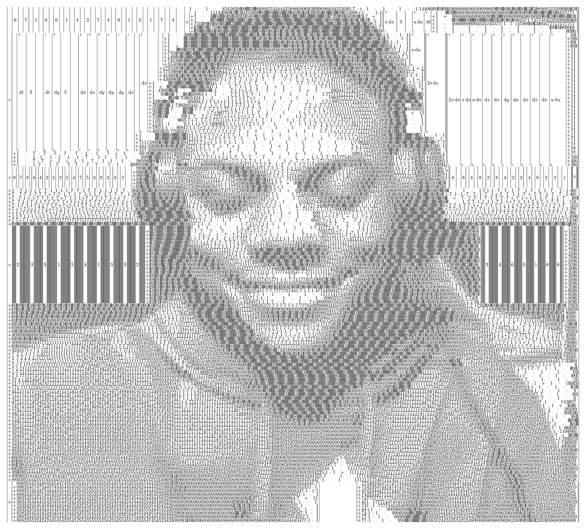

# A portrait that is one integer



This picture is a single mathematical expression, typeset in LaTeX.
It evaluates to a 220-digit integer:

```
20933085614569928271348620629319806063957319928223862732707204554184676221
03117633301626583972756499090119088608916735703124752523838466376999206871
199705654051555884435369889596575381861178898181445402799646275283208489
```

## The mathematics is elementary

The expression needs no key. It is built from five things, each with its usual meaning:

- decimal integers such as `8853`;
- products, written by juxtaposition or with a centred dot: `7·1·[6]⌊3⌋`;
- sums, written with `+`. A long sum is broken over several lines inside one tall pair of
  brackets, and every line after the first begins with `+`;
- grouping brackets `[ ]`, floor `⌊ ⌋` and ceiling `⌈ ⌉`, always around a positive integer;
- definite integrals of polynomials, such as `∫₀³ dx` or `∫₁² 2t dt`, drawn with a tall sign.

That is all: 223 lines of sums, 19,954 delimiter strokes, 16,616 numerals,
381 plus signs, 1,816 multiplication dots and 26 integrals.

## The picture is the structure

One font, one weight (New Computer Modern). Nothing is shaded:

| Tone | What is on the page |
| --- | --- |
| white | space between factors |
| lightest | tall integral signs, far apart |
| light | tall bracket pairs around a single numeral |
| mid | runs of numerals: 1 and 7 are light, 6 and 9 are dark |
| dark | numerals inside deeper and deeper nests of `[ ]`, `⌊ ⌋`, `⌈ ⌉` |

Where the picture is vertically even and reaches the edge (sky, sea), the strokes run the full
height of the region. The figure is set in fine lines.

## Check it yourself

```
tectonic portrait.tex      # typesets the picture from body.tex
python3 verify.py          # evaluates the expression twice and compares with value.txt
```

`expression.txt` is the same expression on one line, in plain calculator syntax: integers, `*`,
`+`, parentheses, `floor()`, `ceiling()` and `integrate(f, (x, a, b))`. `verify.py` evaluates it
with a small exact evaluator of its own and again with SymPy. Both give the integer above.

## Files

| File | What it is |
| --- | --- |
| `portrait.png`, `portrait.pdf` | the expression, nothing else |
| `poster.pdf` | the expression with its value printed underneath |
| `body.tex`, `kit.tex`, `portrait.tex`, `poster.tex` | the LaTeX; `kit.tex` holds the layout macros |
| `expression.txt`, `value.txt` | the expression on one line, and the integer it equals |
| `verify.py`, `verification.txt` | the independent check and its output |
| `build.py`, `calib.py`, `calib.json` | the generator and the font measurements it uses |

## Honest notes

- A bracket, floor or ceiling around a positive integer does not change it. Those strokes are
  the shading; the products, sums and integrals are what compute. Misreading which of the three
  a stroke is cannot change the value.
- The darkest structure reaches about 42% ink, so the picture is paler than a photograph.
- The source photograph is not in this repository. `build.py` expects one as `source.png`;
  everything else rebuilds from the files here.
- Built with [Tectonic](https://tectonic-typesetting.github.io) (XeTeX) and Python.
